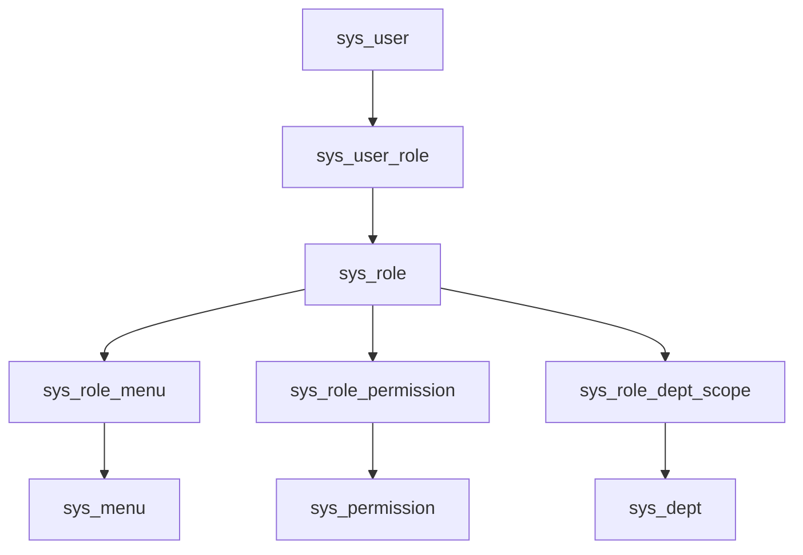

# RBAC 权限判定设计

## 1. 目标与范围

本文档用于将当前仓库中的 RBAC 草稿整理为可直接指导开发的一期设计，目标是完成管理端的基础权限闭环：

- 用户登录后能够初始化当前用户的角色、权限和菜单上下文
- `Sa-Token` 的 `@SaCheckRole`、`@SaCheckPermission` 可以真正生效
- 前端可以基于后端返回的菜单和权限码做菜单显隐、按钮显隐和接口调用控制
- 超级管理员可以走简单兜底逻辑，避免一期实现过度复杂

一期范围包含：

- 用户、角色、菜单、权限、数据范围的模型定义
- 登录态中的 RBAC 上下文初始化
- `StpInterfaceImpl` 的角色/权限查询实现
- 菜单可见性和接口/按钮权限控制
- 权限缓存与失效策略

一期暂不包含：

- 行级数据权限 SQL 自动拼接
- 字段级权限裁剪
- 多租户权限隔离的完整实现
- 前端路由渲染细节

---

## 2. 当前现状

截至 2026-11-12，平台已有角色、权限、菜单及关联表，`StpInterfaceImpl` 通过 `IAuthCommonService` 实时查询有效角色和权限；`/auth/info` 返回 `AuthInfoVo`，`/auth/routers` 返回当前有效菜单路由。Controller 位于 `vita-admin`，服务与持久化位于 `vita-service`。

请求上下文实时加载启用且未删除的用户，角色与权限不使用跨请求缓存。相关撤权变更提交后，新请求按新状态判断。

尚未实现公司、多任职与业务数据范围。现有 `data_scope_type` 和 `sys_role_dept_scope` 尚未形成查询隔离；后续按 `docs/architecture/system/group/group-foundation-design.md` 重构授权模型，不能把功能权限视为数据权限。

---

## 3. 权限模型

### 3.1 核心关系



### 3.2 关键表职责

- `sys_user`
  - 用户基础信息
  - `status`：1 启用，0 禁用
  - `is_super_admin`：唯一超级管理员用户标记，也是运行时唯一判定来源
  - `is_system`：是否系统内置用户，仅用于运维保护，不直接决定权限
- `sys_role`
  - 角色编码 `role_code`
  - 数据范围类型 `data_scope_type`
- `sys_menu`
  - 用于菜单树、路由渲染、页面入口显隐
- `sys_permission`
  - 用于接口/按钮/动作权限控制
  - `permission_code` 与 `auth_tag` 是权限判定主键
- `sys_user_role`
  - 用户与角色关联
- `sys_role_menu`
  - 角色与菜单关联
- `sys_role_permission`
  - 角色与权限关联
- `sys_role_dept_scope`
  - 角色与自定义部门数据范围关联，仅在后续数据权限阶段参与

### 3.3 一期有效数据过滤规则

RBAC 查询应统一过滤以下条件：

- `status = 1`
- `is_deleted = 0`
- 关联表记录未逻辑删除
- 菜单、权限、角色按 `sort_no` 或 `role_sort` 进行稳定排序

若后续接入租户能力，再统一追加：

- `tenant_id = 当前租户`

---

## 4. 超级管理员判定规则

为避免一期设计过于复杂，超级管理员采用“简单兜底”策略。

### 4.1 判定优先级

判定规则只有一条：

1. 若 `sys_user.is_super_admin = 1`，直接视为超级管理员
2. 否则，按普通 RBAC 模型聚合角色、权限和菜单

### 4.2 超级管理员效果

超级管理员应具备以下特性：

- `getRoleList` 可以返回一个框架用的虚拟角色码 `SUPER_ADMIN`，不依赖角色表落库
- `getPermissionList` 返回 `["**:**:**"]`
- 菜单查询返回全部启用菜单
- 不需要依赖 `sys_role_permission` 和 `sys_role_menu` 中的配置完整性

### 4.3 `is_system` 的使用边界

`is_system` 不参与运行时鉴权，它只用于后台管理保护，例如：

- 系统内置角色不允许删除
- 系统内置菜单不允许随意停用
- 系统内置权限不允许直接改编码

---

## 5. 运行时模型设计

### 5.1 设计目标

运行时不应每次校验权限都重新走全量表关联查询，而应先构建当前登录用户的权限快照。数据库访问统一遵循“无 join、service 聚合”的约束。

### 5.2 建议的快照内容

建议将 RBAC 上下文拆成两层：

#### 基础登录用户快照

当前 `vita-common/src/main/java/com/vita/auth/model/LoginUserInfoModel.java` 继续保留，用于存放：

- 用户 ID
- 用户名
- 昵称
- 部门 ID
- 超级管理员标记
- 系统内置标记
- 登录终端信息

#### RBAC 权限快照

不在 Sa-Token Session 中保存角色码、权限码或用户资料。当前请求内的用户资料由 `LoginUserInfoModelContext` 持有，权限查询根据传入的账号 ID 实时执行；菜单与接口权限分别从各自关联表取得，均排除停用角色。

### 5.3 `/auth/info` 返回对象

建议将当前 `/auth/info` 的返回升级为聚合型响应，例如 `AuthInfoVo`：

```json
{
  "userInfo": {
    "id": 1,
    "username": "admin",
    "nickName": "系统管理员",
    "deptId": 100,
    "isSuperAdmin": 1,
    "isSystem": 0
  },
  "roleCodes": [
    "SUPER_ADMIN",
    "SYSTEM_ADMIN"
  ],
  "permissionCodes": [
    "**:**:**"
  ],
  "menus": [
    {
      "id": 1000,
      "parentId": 0,
      "menuName": "系统管理",
      "routeName": "System",
      "routeLink": "/system"
    }
  ]
}
```

如果当前前端尚未联调，可以直接改造 `/auth/info`；若已存在兼容压力，则建议新增 `/auth/context`。

---

## 6. 权限判定流程

### 6.1 登录流程

`POST /auth/login` 一期不建议承载完整 RBAC 初始化，只负责：

1. 用户名密码认证
2. 用户状态校验
3. 建立 Sa-Token 登录态并设置当前请求用户上下文
4. 返回 token 和基础用户信息

设计原因：

- 登录链路要尽量短
- RBAC 聚合涉及多张表，放在登录链路会抬高 RT
- 当前仓库已有 `/auth/info`，更适合做登录后的初始化接口

### 6.2 权限初始化流程

登录成功后，前端调用 `GET /auth/info`：

1. 从当前请求上下文获取实时加载的有效账号信息
2. 根据 `userId` 查询当前有效角色码和权限码
3. 构建 `AuthInfoVo` 返回前端；菜单由 `/auth/routers` 单独返回
4. 不读写跨请求 RBAC 缓存，前端按钮显隐不能替代后端鉴权

### 6.3 `StpInterfaceImpl` 判定流程

1. 只接受默认管理账号域和合法的正整数 `loginId`
2. 根据传入的 `loginId` 查询有效账号，不能使用当前请求其他用户的资料
3. 启用的超级管理员返回虚拟角色或通配权限；普通用户查询启用角色对应的启用权限
4. 每次检查实时查询；账号、角色、权限或关联变更提交后的新请求使用新状态

### 6.4 菜单控制流程

用户可见菜单 = 当前用户启用角色关联到的启用菜单集合。

处理规则：

- 同一菜单被多个角色关联时去重
- 只返回启用且未删除的菜单
- 先查平铺数据，再在 service 层组装树结构
- `visible = 0` 的菜单不进入前端展示树
- `status = 0` 的菜单一律不返回

### 6.5 接口/按钮权限控制流程

用户权限 = 当前用户启用角色关联到的启用权限集合。

使用规则：

- `@SaCheckPermission("system:user:add")`
- 前端按钮显隐根据 `permissionCodes` 判定
- `auth_tag` 建议默认与 `permission_code` 保持一致，避免双字段语义漂移

### 6.6 数据权限扩展点

一期不做 SQL 自动拼接，但应明确后续入口：

- 角色表 `data_scope_type`
- 自定义范围表 `sys_role_dept_scope`
- 用户自身 `dept_id`
- 通用拦截位置建议落在 service -> mapper 的查询拼装层

---

## 7. 查询设计建议

### 7.1 角色查询

按 `userId` 查询角色编码，统一采用两段式：

1. `sys_user_role` 单表查询 `roleIds`
2. `sys_role` 单表按 `roleIds + status=1` 查询角色详情或角色编码

### 7.2 权限查询

按 `userId` 查询权限编码，按以下顺序查询：

1. `sys_user_role` 单表查询 `roleIds`
2. `sys_role` 筛选启用且未删除的 `roleIds`；为空则返回空权限
3. `sys_role_permission` 单表查询 `permissionIds`
4. `sys_permission` 单表按 `permissionIds + status=1` 查询权限详情并映射 `authTag / permissionCode`

### 7.3 菜单查询

按 `userId` 查询菜单，按以下顺序查询：

1. `sys_user_role` 单表查询 `roleIds`
2. `sys_role` 筛选启用且未删除的 `roleIds`；为空则返回空菜单
3. `sys_role_menu` 单表查询 `menuIds`
4. `sys_menu` 单表按 `menuIds + status=1` 查询菜单详情，再在 service 中组装菜单树和前端路由

### 7.4 约束总结

- mapper 只保留单表查询、单表投影、`exists/count`
- service 负责去重、过滤、树结构组装、路由组装
- 文档和实现都不再引入 `join` SQL 示例

---

## 8. 实时鉴权策略（2026-11-12）

当前不在 Session 或 Redis 中缓存用户资料、角色码和权限码。`LoginUserContextInterceptor` 每次请求加载启用且未删除的账号；`StpInterfaceImpl`、`/auth/info`、菜单查询直接读取有效授权。停用账号在仅要求登录的接口也必须被拒绝。

不采用“要求重新登录才生效”或“缓存未命中才回源”的撤权策略。已经执行中的请求不追溯中断；撤权提交后的新鉴权查询生效。账户重新启用和密码重置的全终端会话撤销属于后续工作。

后续缓存优化必须先验证授权版本、失效时限与故障拒绝，并覆盖多实例撤权测试。集团公司及任职范围见 `docs/architecture/system/group/group-foundation-design.md`；当前功能 RBAC 不代表数据隔离已经实现。

---

## 9. 模块落点设计

### 9.1 `vita-common`

负责公共鉴权能力：

- `AuthConstants`：补充 RBAC session key
- `LoginUserInfoModel`：保留基础用户信息

### 9.2 `vita-service`

负责 RBAC 聚合与认证编排：

- 由 `IAuthCommonService` 提供角色、权限、菜单聚合查询
- 用户、角色、菜单、权限相关 mapper 只提供单表查询与单表投影方法
- `AuthServiceImpl` / `IAuthService` 增加当前用户权限初始化能力

### 9.3 `vita-admin`

负责对外接口和注解使用：

- `AuthController` 暴露聚合型权限初始化接口
- 业务 controller 逐步接入 `@SaCheckPermission`
- 需要时新增“当前用户菜单树”接口

## 10. 风险与注意事项

### 10.1 超级管理员单一来源

超级管理员只有一个用户时，不应再在角色表保留 `is_super_admin` 语义。

本文建议：

- 只保留 `sys_user.is_super_admin`
- `sys_role` 不再承担超级管理员语义
- 运行时超管判定不依赖角色关联
- 若需要 `@SaCheckRole("SUPER_ADMIN")`，由 `StpInterfaceImpl` 返回虚拟角色码即可

### 10.2 `permission_code` 与 `auth_tag` 双字段可能漂移

若两个字段允许不一致，会导致：

- 注解写的是 `permission_code`
- `StpInterfaceImpl` 返回的是 `auth_tag`
- 最终授权结果不一致

一期建议直接约束：

- 无特殊需求时，`auth_tag = permission_code`

### 10.3 菜单权限和接口权限不要混用

菜单返回给前端主要用于页面入口展示；
接口权限主要用于按钮和接口调用控制。

两者关联但不等价，不建议只靠菜单控制接口安全。

---

## 11. 一期验收标准

满足以下条件即可认为 RBAC 一期闭环完成：

- `GET /auth/info` 能返回当前用户角色码、权限码、菜单数据
- `StpInterfaceImpl.getRoleList` 能返回正确角色集合
- `StpInterfaceImpl.getPermissionList` 能返回正确权限集合
- `@SaCheckPermission` 在至少一个管理端接口上验证通过
- 超级管理员用户无需配置角色权限也可通过鉴权
- 普通用户只拥有角色分配到的菜单和权限
- 角色、权限、菜单停用提交后，后续请求直接使用新状态
