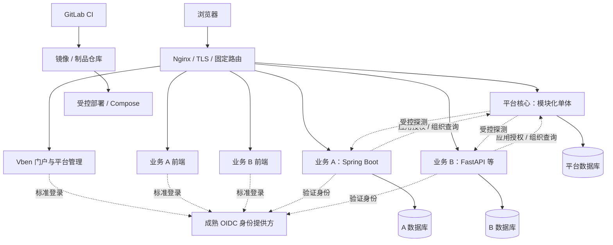

# 目标架构、方案比较与路线图

[返回导航](../README.md) · 这里只描述未来方向，V0.1 不实现全部能力。

## 推荐目标



平台管理身份映射、组织、应用授权、应用目录、导航、版本与健康快照。业务应用管理业务规则、事务、迁移、资源权限和数据。平台不持有通用容器管理权，也不执行应用提交的任意Shell。

## 三种演进方案

| 维度 | A 最小改造 | B 渐进平台 | C 完整平台化 |
| --- | --- | --- | --- |
| 适用 | 少量应用、短期验证 | 小团队持续接入部门应用 | 多实例、频繁发布、专门平台团队 |
| 复用 | 最高 | 高，逐步整理 | 中，新增治理组件多 |
| 身份 | Sa-Token + 受保护校验接口 | 成熟OIDC + 平台业务授权 | 完整会话、密钥与多环境治理 |
| 前端 | 门户与外链 | 独立入口、Manifest、版本化共享包 | 可选微前端工作台 |
| 发布 | 人工/基础脚本 | 每应用流水线、健康、回滚 | 多实例、蓝绿与自动策略 |
| 成本 | 初期低，容易集中耦合 | 中，随需求增长 | 高，运维面大 |

**只推荐 B。**A可作为V0.1起点；C的能力按需求加入。不能因为C功能最多就优先建设。

## 身份演进

- V0.1保留Sa-Token，只给平台自身使用。
- 极少量受控应用可以暂用平台校验接口，但须定义调用方认证、超时、缓存、撤销和应用授权。
- 独立应用扩展前优先调研企业IdP；没有时评估成熟OIDC服务，不自研授权服务器。
- 保留平台用户、组织和RBAC，未来通过 `(issuer, subject)` 映射用户；不按可变用户名或邮箱自动合并。
- 不共享JWT签名密钥、平台Redis Session格式或平台数据库。
- ID Token与API Access Token职责不同，JWT本身不是完整SSO。

参考：[OIDC Core](https://openid.net/specs/openid-connect-core-1_0.html)。

## 前端演进选择

| 方式 | 独立发布 | 主要取舍 |
| --- | --- | --- |
| 全部页面放Vben | 无 | 平台页面合适，长期部门业务会耦合 |
| 门户+独立入口 | 有 | 当前推荐，整页导航，应用自己管理路由和状态 |
| iframe | 有 | 适合少量遗留系统，需登录与消息协议 |
| 微前端 | 有 | 挂载、状态、CSS、依赖与错误隔离成本更高，暂缓 |
| Manifest | 取决于承载方式 | 是描述协议，不是应用加载运行时 |

共享组件通过版本包复用，不要求每个应用同时升级。只有明确需要同屏多应用、跨应用标签或深度交互时再评估微前端。同源不同路径不是安全隔离边界；低信任应用应独立源。

Design System先统一语义Token与少量组件API，第二个真实消费者出现后再拆包和试点Storybook。Agent需要稳定的Props/Events/Slots、状态、示例和验收图，不需要先建设完整AI设计平台。

## 应用接入契约预案

```json
{
  "manifestVersion": "1.0",
  "appId": "asset-manager",
  "name": "资产管理",
  "version": "0.1.0",
  "permissionNamespace": "asset-manager",
  "apiPrefix": "/api/apps/asset-manager",
  "frontendEntry": "/apps/asset-manager/",
  "healthPath": "/health/ready",
  "platformCompatibility": {"min": "0.2.0", "maxExclusive": "1.0.0"}
}
```

应用声明名称、版本、相对端点和兼容范围；平台审核appId、命名空间、前缀、入口和负责人。enabled是平台状态，上游地址来自环境配置，不由公开Manifest决定。

注册需防路由覆盖、保留命名空间冲突和SSRF：受控服务目录、相对路径、禁重定向、地址白名单、DNS与超时/响应大小约束。应用声明权限不等于自动获权。未知契约主版本拒绝，兼容次版本按白名单处理。

V0.2流程：提交Manifest与测试→管理员登记→配置身份客户端/授权→配置固定Nginx路由→验健康和直接API越权→开放门户。V0.1不实现该注册链路。

## 版本路线与验收

| 阶段 | 任务和依赖 | 验收重点 | 风险 |
| --- | --- | --- | --- |
| V0.1 | 修安全、契约、IAM、菜单；依赖隔离测试环境 | 登录/撤权、动态路由、迁移与平台部署闭环 | 旧账号迁移、菜单组件不一致 |
| V0.2 | IdP验证、应用目录、独立Java应用及前端/数据库；依赖V0.1与网络决策 | 无重复输密码；直接API无权拒绝；应用离线不拖垮门户；不能读取平台库 | 身份当授权、同源互信、SSRF |
| V0.3 | 独立镜像、GitLab流水线、迁移/备份/发布记录；依赖运行服务器和制品仓库 | 更新A不重启B；A失败可恢复；数据库不兼容有预案 | 全栈重建误伤、Schema阻止回滚 |
| V1.0 | 真实应用、FastAPI样例、契约测试、模板、监控与恢复；依赖独立发布验证 | 新应用按文档接入；兼容窗口、撤权时限、RPO/RTO可验证 | 核心吞业务、共享组件强制全量发布 |

## 必须区分的能力

逻辑模块化是代码边界；进程隔离是进程故障边界；独立部署是A升级不重启B；零停机还需要双实例/蓝绿、就绪和连接排空；机器级高可用需要多机及关键依赖高可用。

单机Compose可起步，但不提供以上全部保障。平台、IdP、数据库仍可能是共享故障点；授权缓存必须有界，不能无限沿用旧权限。

## 初始资源讨论基线

平台1–2GiB、每个轻量Java应用0.75–1.5GiB、Python应用0.25–1GiB；本机MySQL2–4GiB、Redis0.25–1GiB、IdP预留1–2GiB，另留系统和监控余量。平台加两个轻量应用可先讨论4–8vCPU/16GiB，**只是预算假设，不是容量承诺**。

构建放Runner；磁盘另算数据库、镜像、日志与备份。网络规划固定HTTPS入口、私有数据库/Redis、制品仓库、部署通道、DNS/NTP和证书。参考：[Compose生产部署](https://docs.docker.com/compose/how-tos/production/)。

