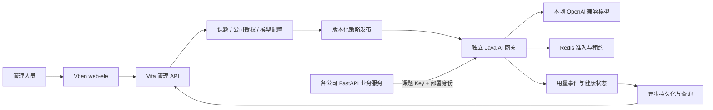

# 项目评估与技术选择

日期：2026-11-13。结论基于当前仓库静态审查及本地 `lithe-api` 参考代码；本次没有运行真实模型压测。

## 1. 结论

**选择 Java，新增独立网关应用，继续放在 Modular Hub 统一仓库内。** 当前项目适合作为管理和组织权限的基础，但网关转发层需要单独建设。无需重建整个后台，也无需新建另一个 Git 仓库。

推荐候选：`backend/vita-ai-gateway`，JDK 17 + 当前 Spring Boot BOM 管理的 WebFlux / Reactor Netty。这是独立启动、独立资源配置、独立发布的基础设施应用，不属于 `cw-aiaudit` 等部门业务。此目录和 Maven 模块目前尚未创建。

## 2. 仅比较性能与稳定性：Java 与 FastAPI

比较对象必须对等：Java 使用非阻塞网络栈和复用连接池；FastAPI 使用异步 ASGI 服务和复用异步 HTTP 客户端。不能用优化过的 Java 代理对比混有 OCR、同步数据库和业务处理的完整 Python 应用。

| 维度 | Java WebFlux / Reactor Netty | FastAPI / 异步 HTTP 客户端 | 对本项目的判断 |
| --- | --- | --- | --- |
| 单次请求延迟 | 非阻塞不等于单次调用更快；仍有鉴权、编解码、GC 和网络成本 | 轻量异步代理也可能有很低的额外延迟 | 不预设谁必胜，测首个有效输出和额外延迟 |
| 大量 SSE 长连接 | 事件循环与背压适合控制慢客户端和缓冲区 | 同样可以异步流式转发，必须正确关闭上游连接 | 两者可胜任；Java 是本项目优先验证的长期实现 |
| 高负载处理余量 | 可将连接处理、统计和其他 CPU 工作分配到受控执行资源 | 可通过多 worker / 多实例利用多核；容量要按所有进程合计 | 预计 Java 有较好的处理余量，但具体上限必须测量 |
| 长期运行稳定性 | 取决于缓冲上限、取消、超时、GC、直接内存与连接回收 | 取决于事件循环、取消、连接回收、worker 和队列管理 | 没有语言级的稳定性保证；故障和持续运行测试决定是否达标 |
| 上游慢、客户端慢、服务故障 | 需要明确背压、隔离和熔断策略 | 也需要同样的策略 | 设计要求相同，不能靠更换语言自动解决 |

Spring 官方把 WebFlux 的主要价值描述为在高延迟 I/O 下以较少线程处理并发，而不是自动缩短每次请求的时间。这支持本项目采用非阻塞转发的方向，**不构成 Java 胜过 Python 的基准证据**。[Spring Framework 6.2：并发与性能](https://docs.spring.io/spring-framework/reference/6.2/web/webflux/new-framework.html)

Python 的事件循环也能有效处理 I/O，但在事件循环中运行阻塞或 CPU 密集任务会延迟其他任务；Java 事件循环同样必须避免阻塞。[Python asyncio 开发说明](https://docs.python.org/3.12/library/asyncio-dev.html) HTTPX 已提供异步流式代理所需能力，官方特别要求复用客户端并关闭手动打开的响应流。[HTTPX 异步支持](https://www.python-httpx.org/async/)

因此，**性能与稳定性优先时，本项目选择 Java 非阻塞网关作为实施方向**。理由是预期的集中并发、持续流式连接和后续鉴权统计负载，需要重点控制资源上限和过载行为；这个判断仍须实测验证。不能承诺“Java 快几倍”，也不能说 FastAPI 不稳定。JDK 17 方案不依赖虚拟线程。

## 3. 当前代码的适配情况

| 现有内容 | 审查发现 | 处理建议 |
| --- | --- | --- |
| [Maven 父工程](../../backend/pom.xml) | Java 17、Spring Boot 3.5.0；已有独立应用的构建模式 | 复用构建和版本基线，不为网关整体升级技术栈 |
| 平台管理与认证 | 已有账号、RBAC、菜单、字典等管理能力 | 复用人员管理入口；网关机器调用采用独立凭据认证 |
| [vita-common](../../backend/vita-common/pom.xml) | 同时依赖 Servlet MVC、MyBatis、数据源、Sa-Token Servlet 集成 | 不直接整体引入纯 WebFlux 运行时；按公开契约复用，必要时抽取轻量 starter |
| [默认异步线程池](../../backend/vita-common/src/main/java/com/vita/async/config/ThreadPoolConfig.java) | 使用 `DiscardPolicy`，队列满时可丢任务 | 不用于关键用量记录；网关要显式处理积压、失败和重放 |
| 现有操作日志 | 面向管理请求及方法返回，无法天然覆盖 SSE 完整生命周期 | 管理审计继续使用；模型请求另建生命周期事件，禁止记录正文和凭据 |
| 公司权限 | 已有集团需求与设计，当前实现未完成公司隔离 | 网关不得宣称自动继承隔离；公司授权和部署归属作为明确交付项 |
| 四个部门应用 | 当前主要是独立打包及模块名接口骨架 | 保持业务边界；网关作为它们的外部公共服务 |
| 统一返回体规范 | 平台接口要求 `CommonResult<T>` | 实现前补充仅限外部 `/v1/*` 的协议例外；管理端仍保持现有规范 |

本地参考 `lithe-api` 的审查结果如下。由于它不纳入 Git，下列路径只用于说明证据，不作为仓库文档的链接依赖。

| 参考路径 | 事实 | 对网关的影响 |
| --- | --- | --- |
| `app/infra/ai/registry.py`、`model_service.py` | 有模型池、`fast/strong` 入口与客户端生命周期管理 | 可以借鉴职责划分，业务端保留简薄适配接口 |
| `app/infra/ai/clients/chat.py` | 使用复用的异步客户端；返回首个 choice 的文本、model、usage | 不能直接当透明代理：完整响应、工具调用和 SSE 都要独立验证 |
| `app/core/lifespan.py`、`app/web/dependencies.py` | 多业务模块共享进程级模型服务 | 不可按请求修改全局 Key；必须使用隔离的课题调用上下文 |
| `app/web/routers/llm.py` 与各业务模块 | HTTP 路由有审计包装，但业务内部也直接调用模型方法 | 只监控路由不足以汇总所有模型请求，统一网关能覆盖实际出口 |
| `app/core/invocation_audit.py` | 有界内存队列；队列满丢记录，数据库失败无持久重试 | 可以参考异步思路，不能作为完整 Token 账本 |
| `app/web/routers/health.py` | 存活检查及可选数据库检查，未验证模型实际生成 | 必须增加模型端点、协议、实际推理三层检测 |
| `app/infra/ai/preprocessing/multimodal.py` | 图片、PDF 等预处理在业务调用前进行 | 留在业务侧，不进入转发服务关键路径 |
| 依赖与持久化 | 同时包含大量业务依赖及 SQL Server 相关代码 | 不适合原样裁剪成基础设施网关后直接部署 |

现有 Python 调用链可能已有 SDK 重试及业务重试。网关引入前必须盘点并统一重试责任；初版关闭网关自动重试，区分逻辑请求与实际上游尝试，避免故障时放大模型负载。

## 4. 建议的应用边界

- **管理层**：人员登录、课题申请审批、公司推广授权、Key 生命周期、配置发布、看板。复用平台管理体系，具体实现模块在技术详设确定。
- **转发层**：机器身份校验、模型路由、有界并发、JSON/SSE 转发、取消、超时、健康探测和事件产生。请求期间不查询管理页面或同步写 MySQL。
- **统计层**：异步消费、幂等落库、聚合、补偿和展示。与转发共享契约，但不占用转发事件循环执行阻塞操作。
- **业务层**：提示词、文件解析、OCR、业务校验、业务任务重试继续留在原服务中。网关健康不等同于业务全链路健康。

共享代码只抽取必要契约、标识和轻量工具，避免全包扫描、跨模块访问内部 Mapper，或将 `vita-common` 的 Servlet 自动配置带入网关。首次实施需同步现有 [后端规则](../../backend/AICoding/rules/be-vita-ai-codegen-rules.md) 中的新模块边界和协议例外；本轮不改代码规则。

## 5. 打包与上线可行性

本地解析 Maven 依赖并生成带运行依赖的可执行 JAR，线上使用 OpenJDK 17 启动。WebFlux 等新增 Java 依赖随制品交付，不要求服务器在线下载 Maven 包。配置、密钥和证书通过外部配置提供，不写入 JAR。

这解释了交付方式可行，**不参与第二节的性能胜负判断**。实际仍需 M1 在目标操作系统验证 JAR、TLS/本地传输库、文件权限和配置；不能把“本机打包成功”当作目标环境已验证。

## 6. 实施前必须收敛的风险

1. **公司归属可信度**：共享课题 Key 不能证明公司，单独传 `company_id` 不足以可靠隔离。PRD 推荐绑定公司和环境的部署证书，M0 验收该身份方案。
2. **上游协议差异**：先采集实际部署的模型服务版本和能力，特别是 usage、工具调用、SSE 终止和取消行为。
3. **长连接资源泄漏**：模拟慢客户端、断连、超时、半开连接及重启；监测堆、直接内存、连接和文件描述符。
4. **集中网关故障影响面**：至少验证双实例切换；如果数据库、Redis、入口或宿主机仍单点，明确其可用性边界。
5. **性能与可靠统计的权衡**：异步统计也有丢失窗口和磁盘成本；明确恢复与缺口语义，不宣称免费实现零开销、零丢失。

对应执行顺序见 [迭代计划](03-iteration-plan.md)，通过条件见 [人工验收里程碑](04-acceptance-checklist.md)。
