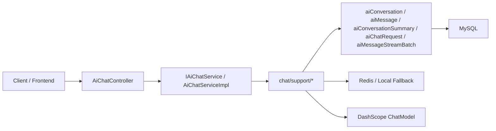
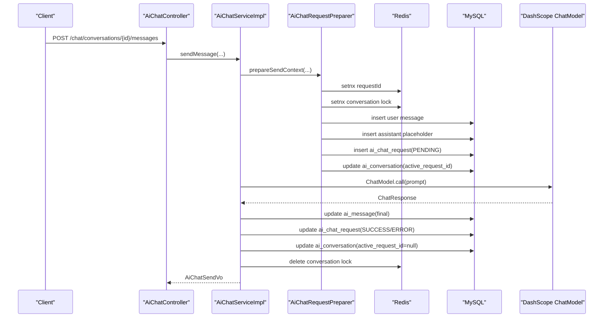
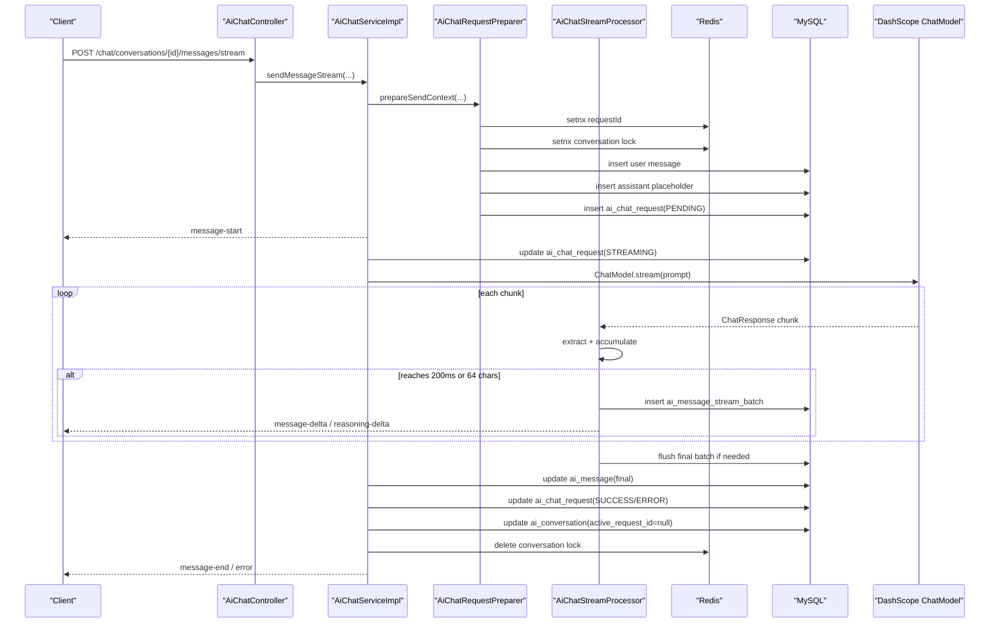

# be-vita AI Chat 设计文档

## 1. 文档目标与定位

本文档面向 `vita-aichat` 后端研发与维护者，基于当前仓库中的真实实现说明 AI Chat 模块的设计思路、核心链路和演进边界。

事实来源以以下实现为准：

- 表结构：`sql/init/aichat.sql`
- 接口入口：`com.vita.controller.aichat.AiChatController`
- 聚合服务：`com.vita.aichat.chat.service.impl.AiChatServiceImpl`
- 支撑组件：`com.vita.aichat.chat.support.*`

如果旧文档与当前代码冲突，以当前代码行为为准。

当前模块的目标是提供一个稳定的会话式 AI Chat 基础能力：

- 保持 `Spring MVC + SseEmitter` 技术栈
- 统一通过 `spring-ai-alibaba-starter-dashscope` 调用 DashScope
- 支持同步回复和流式回复
- 支持请求防重、会话级并发控制、结果持久化和流式切片落库
- 为后续扩展 AI agent 能力预留清晰的结构边界

## 2. 模块架构

### 2.1 依赖与配置入口

当前模型接入依赖：

```xml
<dependency>
    <groupId>com.alibaba.cloud.ai</groupId>
    <artifactId>spring-ai-alibaba-starter-dashscope</artifactId>
</dependency>
```

当前业务配置由 `AiChatProperty` 读取，启动阶段由 `AiChatConfiguration` 做校验。关键配置项如下：

```yaml
spring:
  ai:
    model:
      chat: dashscope
    default-system-prompt: 你是一个严谨的开发助手。
    max:
      context:
        messages: 12
    stream:
      enabled: true
    connect:
      timeout: 5000
    read:
      timeout: 60000
    dashscope:
      api-key: your-api-key
      base-url: https://dashscope.aliyuncs.com
      chat:
        options:
          model: qwen-plus
```

启动校验会显式检查：

- `spring.ai.model.chat` 只允许 `dashscope`
- `spring.ai.dashscope.api-key` 必须存在
- `spring.ai.dashscope.base-url` 必须存在
- `spring.ai.dashscope.chat.options.model` 必须存在

### 2.2 架构分层

当前模块按照“控制层 -> 聚合服务层 -> 支撑组件层 -> 领域数据层 -> 外部依赖”组织。



### 2.3 主要职责划分

| 层级 | 组件 | 当前职责 |
| --- | --- | --- |
| Controller | `AiChatController` | 暴露 `/chat/**` HTTP 与 SSE 接口，接收 DTO，返回 `CommonResult` 或 `SseEmitter` |
| Service | `AiChatServiceImpl` | 编排会话创建、消息查询、同步发送、流式发送、异步上下文透传 |
| Support | `AiChatRequestPreparer` | 校验请求、生成 `requestId`、检查会话状态、防重、抢锁、构建 Prompt、落用户消息/助手占位消息/请求记录 |
| Support | `AiChatMessageBuilder` | 构建 `AiMessage` 与 `AiChatRequest` 实体 |
| Support | `AiChatStreamProcessor` | 消费 `ChatModel.stream`、做批次聚合、流式批次落库、发送增量 SSE 事件 |
| Support | `AiChatOutcomeApplier` | 将模型成功/失败结果回写到消息表、请求表、会话表 |
| Support | `AiChatResponseExtractor` | 从 Spring AI 的 `ChatResponse` 中抽取正文、推理内容、finish reason 与 usage |
| Support | `AiChatExceptionConverter` | 将网络、鉴权、超时、限流等异常统一转为业务异常 |
| Support | `AiChatRedisCoordinator` | 维护 `requestId` 防重标记与会话级生成锁 |
| Support | `AiChatSseWriter` | 用 `CommonStreamResult` 封装 SSE 成功/失败事件 |
| Domain | `aiConversation/*` | 会话主状态与配置 |
| Domain | `aiMessage/*` | 逻辑消息与最终聚合结果 |
| Domain | `aiConversationSummary/*` | 历史摘要 |
| Domain | `aiChatRequest/*` | 单次模型请求生命周期 |
| Domain | `aiMessageStreamBatch/*` | 流式批次快照 |

### 2.4 当前公开接口

当前公开接口全部位于 `/chat` 域下：

- `POST /chat/conversations`
- `GET /chat/conversations`
- `GET /chat/conversations/{conversationId}`
- `POST /chat/conversations/{conversationId}/title`
- `DELETE /chat/conversations/{conversationId}`
- `GET /chat/conversations/{conversationId}/messages`
- `POST /chat/conversations/{conversationId}/messages`
- `POST /chat/conversations/{conversationId}/messages/stream`

说明：

- 会话重命名当前使用 `POST`，不是 `PATCH`
- 流式接口返回 `SseEmitter`
- 所有接口都依赖当前登录态，通过 `LoginUserInfoModelContext` 获取用户上下文

## 3. 数据设计与表结构思路

### 3.1 设计原则

当前数据模型不是把一次对话全部塞进一张表，而是按“会话主状态、逻辑消息、请求生命周期、流式过程快照、历史摘要”拆分：

- 会话负责管理状态和运行参数
- 消息负责保存最终可展示内容
- 请求负责记录一次模型调用的生命周期
- 批次负责保存流式过程中的切片快照
- 摘要负责压缩历史，减少上下文窗口压力

这样拆分的原因是：

- 同一条助手消息有“生成中”和“最终完成”两个时间维度
- 流式切片天然不适合直接堆进消息主表
- 请求防重、错误追踪、token 统计更适合放在独立请求表
- 摘要属于上下文压缩产物，不应与实时消息耦合

### 3.2 五张核心表关系

| 表名 | 主键/核心键 | 关系 | 当前职责 |
| --- | --- | --- | --- |
| `ai_conversation` | `id` | 1:N `ai_message` / 1:N `ai_chat_request` / 1:N `ai_conversation_summary` | 保存会话配置、当前模型、摘要状态、最近一次错误和当前活动请求 |
| `ai_message` | `id` | N:1 `ai_conversation` / `reply_to_id` 自关联 / 1:N `ai_message_stream_batch` 间接关联 | 保存用户消息和助手最终结果 |
| `ai_conversation_summary` | `id`, `(conversation_id, version_no)` | N:1 `ai_conversation` | 保存历史摘要及压缩范围 |
| `ai_chat_request` | `id`, `(conversation_id, request_id)` | N:1 `ai_conversation` / 1:1 `user_message_id` / 1:1 `assistant_message_id` | 保存单次模型调用生命周期和幂等追踪 |
| `ai_message_stream_batch` | `id`, `(assistant_message_id, batch_no)` | N:1 `assistant_message_id` | 保存流式回复的批次快照 |

### 3.3 `ai_conversation` 设计思路

`ai_conversation` 解决的是“一个会话当前是什么状态、以什么参数运行”的问题。

关键字段含义：

- `title` / `title_source`：区分自动标题与手动标题
- `status`：控制会话是否允许继续发送消息，当前代码要求必须是 `ACTIVE`
- `current_model_code` / `system_prompt` / `temperature` / `max_tokens` / `max_context_messages`：会话级默认模型参数
- `summary_version` / `summary_status`：描述摘要是否存在、是否过期
- `active_request_id`：标记当前是否有生成中的请求
- `last_error_code` / `last_error_message`：保留最近一次失败态，方便会话页快速展示
- `message_count` / `round_count` / `last_message_at`：为列表展示和排序服务

这张表不存具体消息正文，只存会话主状态和配置。

### 3.4 `ai_message` 设计思路

`ai_message` 只保存逻辑消息，不保存每个原始 token。

核心原则：

- 用户消息和助手消息共用一张表
- `role_type` 区分 `USER`、`ASSISTANT`、`SYSTEM`、`SUMMARY`
- `reply_to_id` 把助手回复和对应的用户消息关联起来
- `content` 与 `reasoning_content` 只保存最终聚合结果
- `content_status` 记录 `GENERATING`、`DONE`、`ERROR`、`CANCELLED`
- `request_id` 和 `provider_request_id` 支撑链路追踪
- `use_context` 决定该消息是否进入后续 Prompt 构建
- `stream_batch_count` 记录这条助手消息对应了多少个流式批次

当前消息类型虽然预留了 `TEXT/IMAGE/FILE/EVENT`，但业务实现只允许 `TEXT`。

### 3.5 `ai_chat_request` 设计思路

`ai_chat_request` 是当前设计中最关键的治理表，解决的是“一次模型调用发生了什么”。

典型用途：

- `requestId` 幂等防重
- 区分同步与流式：`SYNC` / `STREAM`
- 跟踪状态变化：`PENDING -> STREAMING -> SUCCESS/ERROR`
- 记录供应商请求 ID 与 token 使用量
- 将请求与 `user_message_id`、`assistant_message_id` 绑定
- 独立保存错误码、错误信息、完成时间

这张表使得“消息内容”和“请求生命周期”分离，避免把调用过程状态塞进消息主表。

### 3.6 `ai_message_stream_batch` 设计思路

`ai_message_stream_batch` 用来保存流式回复过程中的阶段性快照，而不是原始 token 明细。

核心字段：

- `assistant_message_id`：属于哪条助手消息
- `request_id`：属于哪次请求
- `batch_no`：第几个批次，从 1 开始
- `content_delta` / `reasoning_delta`：本批次的正文与推理增量
- `flush_reason`：为什么触发了本次落库
- `delta_chars`：本批次字符数
- `provider_sequence`：已经消费到的供应商 chunk 序号

当前批次策略以代码常量为准：

- 时间窗口：`200ms`
- 字符阈值：`64`

这张表的价值在于：

- 流式中断时可回溯已落库片段
- 排查模型返回与前端渲染差异
- 后续如需做断点续传、审计或细粒度分析，有真实切片数据可用

### 3.7 `ai_conversation_summary` 设计思路

`ai_conversation_summary` 表示会话历史的压缩结果，而不是原始消息的替代品。

当前设计含义：

- `version_no`：摘要版本
- `source_message_start_id` / `source_message_end_id`：摘要覆盖的消息范围
- `source_message_count`：压缩了多少条消息
- `summary_text` / `summary_json`：摘要正文与结构化摘要
- `token_saved_estimate`：预计节省的上下文开销
- `status`：当前是否可用，代码读取最新 `READY` 摘要

摘要表的职责是“辅助 Prompt 构建”，不承担实时消息持久化。

## 4. 核心业务逻辑

### 4.1 创建会话

创建会话链路较轻，主要完成会话默认值初始化：

1. 从 `LoginUserInfoModelContext` 获取当前用户
2. 生成雪花 ID
3. 处理默认标题，默认值为 `新对话`
4. 处理默认模型编码，默认取 `spring.ai.dashscope.chat.options.model`
5. 处理默认系统提示词和最大上下文消息数
6. 初始化 `summaryStatus=NONE`、`messageCount=0`、`roundCount=0`
7. 落库 `ai_conversation`

### 4.2 查询会话与消息

查询链路的核心点是“按当前登录用户隔离数据”：

- 会话分页：按用户维度查询会话列表
- 会话详情：会校验会话是否属于当前用户
- 消息分页：先校验会话归属，再按会话维度分页拉消息

因此，用户不会直接读到别人的会话或消息。

### 4.3 同步发送消息

同步发送通过 `sendMessage` 走完整闭环。



关键点：

- 同步发送也会先写一条助手占位消息，状态为 `GENERATING`
- 只有成功拿到模型结果后，才会把助手消息回写为最终内容
- 成功和失败都统一通过 `AiChatOutcomeApplier` 回写
- 最后总会释放会话锁

### 4.4 流式发送消息

流式发送在预处理阶段与同步一致，不同点在于模型响应消费和前端输出。



关键点：

- `message-start` 在异步任务提交前就会先发出
- 异步线程会显式透传 `LoginUserInfoModelContext`，保证线程切换后仍能访问用户上下文
- `AiChatStreamProcessor` 负责读取模型流、聚合切片、落批次表、发增量 SSE
- 成功时发送 `message-end`，失败时发送 `error`
- 无论成功失败，最终都会释放会话锁

### 4.5 失败处理与状态清理

失败处理由 `AiChatExceptionConverter + AiChatOutcomeApplier` 完成。

当前错误治理策略：

- 鉴权失败 -> `MODEL_AUTH_ERROR`
- 超时 -> `MODEL_TIMEOUT`
- 限流 -> `MODEL_RATE_LIMIT`
- 网络错误 -> `MODEL_NETWORK_ERROR`
- 其他异常 -> `MODEL_PROVIDER_ERROR`

失败回写时会做三件事：

- 把助手消息标记为 `ERROR` 并写入错误码/错误信息
- 把请求记录标记为 `ERROR`
- 把会话的 `active_request_id` 清空，并记录最近一次错误

### 4.6 Redis 防重与会话锁

当前实现使用两个键：

- `aichat:req:{conversationId}:{requestId}`
- `aichat:conv:{conversationId}:lock`

协作规则如下：

1. 先检查数据库里是否已存在 `(conversationId, requestId)`
2. 再通过 Redis `setIfAbsent` 做请求级防重
3. 然后通过 Redis `setIfAbsent` 做会话级互斥
4. 如果抢会话锁失败，会主动释放刚刚打上的请求标记
5. 如果预处理事务失败，也会释放请求标记与会话锁
6. Redis 不可用时，退化到本地 `ConcurrentHashMap`

这套机制避免了：

- 前端重复点击导致重复落库
- 同一会话多个生成任务并发写消息

## 5. 大模型请求参数构建与响应处理

### 5.1 发送前参数校验与默认值

当前请求准备逻辑由 `AiChatRequestPreparer` 统一处理。

发送前会执行：

- 校验会话是否存在且属于当前用户
- 校验会话状态必须为 `ACTIVE`
- 校验 `messageType` 当前只能是 `TEXT`
- 若前端未传 `requestId`，则使用 `IdUtil.fastSimpleUUID()` 自动生成

默认值规则：

- `title` 为空 -> `新对话`
- `systemPrompt` 为空 -> 走 `spring.ai.default-system-prompt`
- `modelCode` 为空 -> 走 `spring.ai.dashscope.chat.options.model`
- `maxContextMessages` 为空或 `<= 0` -> 走 `spring.ai.max.context.messages`
- `useContext` 为空 -> 默认 `1`

### 5.2 Prompt 构建顺序

当前 Prompt 组装顺序是固定的：

1. `systemPrompt`
2. 最新可用摘要 `summary`
3. 历史上下文消息 `historyMessages`
4. 当前用户消息 `currentUserMessage`

这也是当前实现最重要的上下文构建规则。

### 5.3 历史上下文筛选规则

历史上下文来自 `ai_messageService.listRecentContextMessages(...)`，代码层面的意图是：

- 只取当前会话内的历史消息
- 只取当前用户可见的消息
- 排除刚刚新写入的当前用户消息
- 只取允许参与上下文的消息，即受 `use_context` 控制
- 最多取 `maxContextMessages` 条
- 查询结果在进入 Prompt 前会 `Collections.reverse(...)`，最终按时间正序拼装

消息到 Prompt 的映射规则：

- `USER` -> `UserMessage`
- `ASSISTANT` -> `AssistantMessage`
- `SYSTEM` -> `SystemMessage`
- `SUMMARY` -> `SystemMessage("历史摘要：...")`

### 5.4 DashScope 请求参数构建

当前模型调用使用 DashScope Chat Options，关键参数如下：

| 参数 | 当前来源 | 说明 |
| --- | --- | --- |
| `model` | 会话 `current_model_code`，为空时取默认配置 | 当前请求要调用的模型 |
| `stream` | 由同步/流式接口决定 | 是否开启流式 |
| `incrementalOutput` | 与 `stream` 同步 | 流式模式下按增量返回 |
| `enableSearch` | 固定 `true` | 当前实现默认打开搜索增强开关 |
| `enableThinking` | `modelCode` 以 `qwq-` 开头时为 `true` | 推理模型开启思考模式 |
| `maxToken` | 会话 `max_tokens` | 限制单次最大输出 token |
| `temperature` | 会话 `temperature` | 控制输出随机性 |

说明：

- 当前实现只支持 DashScope，不支持运行时多 Provider 切换
- `current_model_id` / `model_id` 字段已预留，但当前主要使用 `modelCode`

### 5.5 同步响应处理

同步响应处理链路：

1. `chatModel.call(prompt)`
2. `AiChatResponseExtractor.extractCompletion(response)`
3. 从 `ChatResponse` 抽取：
   - `content`
   - `reasoningContent`
   - `finishReason`
   - `providerRequestId`
   - `tokenInput` / `tokenOutput` / `tokenTotal`
4. 如果正文和推理内容都为空，视为无效返回
5. 通过 `AiChatOutcomeApplier.applySuccess/applyFailure` 回写

### 5.6 流式响应处理

流式响应不是直接把 chunk 发给前端，而是先经过一层统一处理。

`AiChatResponseExtractor` 的抽取逻辑：

- 正文：取 `AssistantMessage.getText()`
- 推理内容：取 `AssistantMessage.metadata["reasoningContent"]`
- 结束原因：取 `ChatGenerationMetadata.finishReason`
- token 使用量：取 `ChatResponse.metadata.usage`
- 供应商请求 ID：取 `ChatResponse.metadata.id`

`AiChatStreamProcessor` 的处理逻辑：

1. 遍历 `chatModel.stream(prompt)` 返回的每个 `ChatResponse`
2. 累积完整正文和完整推理内容
3. 将增量片段交给 `AiStreamBatchAccumulator`
4. 满足 `200ms` 或 `64` 字符阈值时落一批 `ai_message_stream_batch`
5. 为正文和推理分别发送 `message-delta` 与 `reasoning-delta`
6. 结束时强制 flush 最后一批
7. 组装 `StreamProcessResult`
8. 最终再统一回写 `ai_message` 与 `ai_chat_request`

### 5.7 SSE 响应协议

当前事件名固定为：

- `message-start`
- `message-delta`
- `reasoning-delta`
- `message-end`
- `error`

SSE 内容通过 `AiChatSseWriter` 统一包装成 `CommonStreamResult` JSON，再写入 `SseEmitter`。

事件体核心字段：

- `conversationId`
- `assistantMessageId`
- `requestId`
- `batchNo`
- `contentStatus`
- `finishReason`

结束事件还会带上：

- `firstTokenAt`
- `completedAt`
- `tokenInput`
- `tokenOutput`
- `tokenTotal`

## 6. AI Agent 相关知识点

当前 `vita-aichat` 还不是完整意义上的 AI agent 框架，但已经具备 AI agent 基础设施中的若干关键能力。

### 6.1 Provider

Provider 指底层模型服务供应商。当前系统的唯一 Provider 是 DashScope。

系统层面已经具备：

- Provider 配置入口
- 启动校验
- 统一异常映射

但尚未实现多 Provider 路由策略。

### 6.2 Model

Model 指具体调用的模型实例，例如 `qwen-plus` 或 `qwq-*`。

当前实现特点：

- 会话维度保存 `current_model_code`
- 每次请求记录 `model_code`
- 可在会话创建时覆盖默认模型
- 推理模型通过 `qwq-*` 前缀触发思考模式

### 6.3 Prompt

Prompt 是当前系统最核心的 agent 输入构造物。

当前设计不是直接拿用户输入发模型，而是把以下信息组合起来：

- 系统设定
- 历史摘要
- 最近上下文消息
- 当前用户输入

这本质上已经是一个最基础的“上下文增强型 agent 输入构建器”。

### 6.4 Context Window

Context Window 指单次送给模型的上下文窗口。

当前系统通过两种方式控制窗口大小：

- `maxContextMessages`：限制实时消息条数
- `ai_conversation_summary`：用摘要压缩更长历史

这说明当前系统已经具备了最基础的短期记忆治理机制。

### 6.5 Summary Memory

Summary Memory 指把历史消息压缩为摘要再参与后续对话。

当前实现中：

- 最新 `READY` 摘要会被插入 Prompt
- 摘要与原消息分表存储
- 摘要版本化管理

这是一种典型的“会话级短期记忆压缩”能力。

### 6.6 Request Lifecycle

Request Lifecycle 指一次用户请求从进入系统到完成的全过程。

当前系统通过 `ai_chat_request` 明确保存：

- 请求模式
- 请求状态
- 关联消息
- token 使用
- 首 token 时间
- 完成时间
- 错误信息

这为未来做 agent trace、链路分析、执行回放提供了基础。

### 6.7 Idempotency

Idempotency 指同一请求多次提交只生效一次。

当前系统的实现方式是：

- 数据库唯一键：`(conversation_id, request_id)`
- Redis `setnx`
- 请求失败时释放无效标记

这是 AI 场景里很重要的基础能力，否则前端重试会造成重复生成和重复计费。

### 6.8 Streaming Snapshot

Streaming Snapshot 指流式输出过程中保留阶段性切片，而不是只保留最终结果。

当前系统的批次表就是这一能力的体现：

- 既保留最终助手消息
- 又保留生成过程中的切片快照

这比只存最终答案更接近 agent runtime 的真实执行轨迹。

### 6.9 Reasoning Content

Reasoning Content 指模型在支持推理模式时输出的思考内容。

当前系统已经支持：

- 从模型 metadata 中提取 `reasoningContent`
- 在同步与流式两条链路中分别返回
- 最终写入 `ai_message.reasoning_content`

这使得系统不只是“展示答案”，还能展示模型的推理痕迹。

## 7. 当前边界与后续演进

### 7.1 当前已具备的基础能力

当前 `vita-aichat` 已具备：

- 多轮会话管理
- 同步/流式两种回复模式
- 请求级幂等和会话级互斥
- 会话摘要接入 Prompt
- 推理内容提取
- 流式切片快照落库
- 错误分类与统一回写

这意味着它已经不是一个“只会转发模型调用”的薄封装，而是具备了一层 AI runtime 的基础治理能力。

### 7.2 当前未落地能力

以下概念可以在文档中被提及，但应明确标记为未落地：

- Tool Calling
- RAG
- 长期记忆
- Planning / ReAct
- MCP / 外部工具编排
- 多 Agent 协作

也就是说，当前系统“已具备 agent 基础能力”，但“尚未实现完整 agent 编排”。

### 7.3 当前实现边界说明

有几处边界需要明确：

- 当前只支持 DashScope，不支持多 Provider 动态切换
- 当前只支持 `TEXT` 消息，图片/文件/事件类型仍属于保留设计
- 流式刷批阈值是代码常量 `200ms / 64 chars`，还没有配置化
- `ai_message_stream_batch` 已有独立领域服务，但当前会话删除链路主要删除 `ai_chat_request`、`ai_conversation_summary`、`ai_message` 与 `ai_conversation`，未在服务层显式串上批次表删除

### 7.4 推荐演进方向

如果后续要把当前 aichat 演进为更完整的 AI agent 平台，建议优先沿以下路径扩展：

1. 让 `ai_chat_request` 承担更完整的 trace 记录
2. 在 Prompt 层引入工具说明和可调用工具上下文
3. 引入知识库检索结果并和摘要一起进入上下文
4. 将流式批次快照升级为可观测的 runtime event 流
5. 在不破坏当前会话模型的前提下扩展 tool calling / memory / planning

当前这套结构的价值就在于：它已经把会话、消息、请求、流式过程、摘要分层拆开，后续扩展 AI agent 能力时不需要推翻重来。
