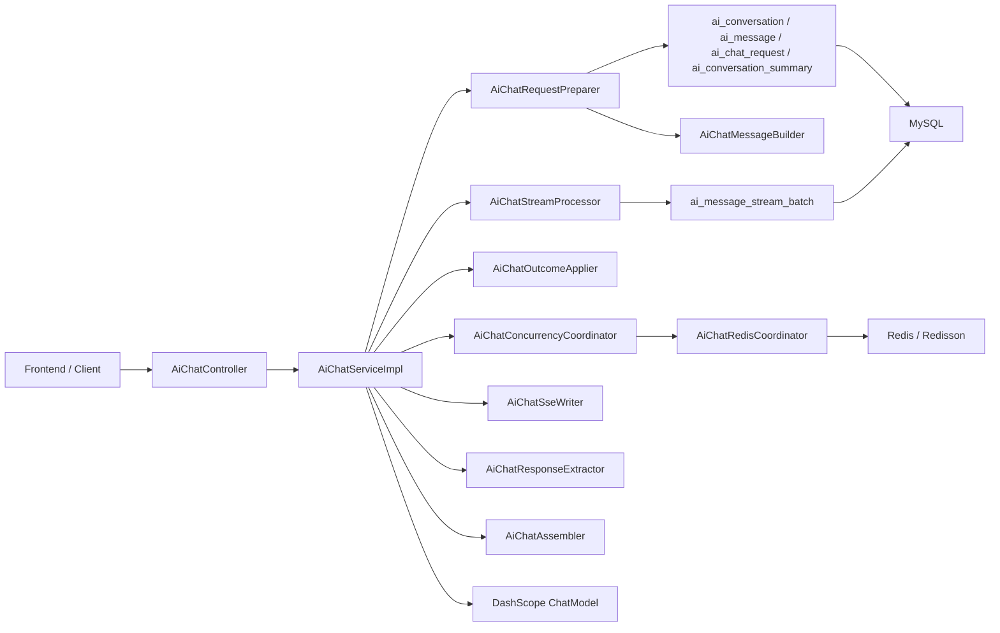
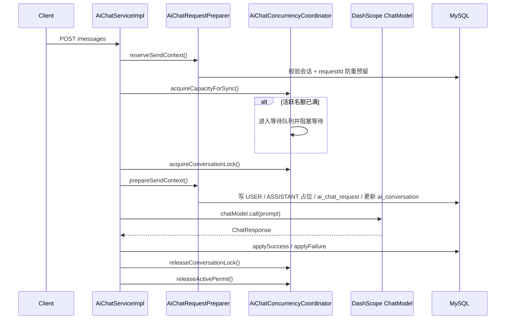
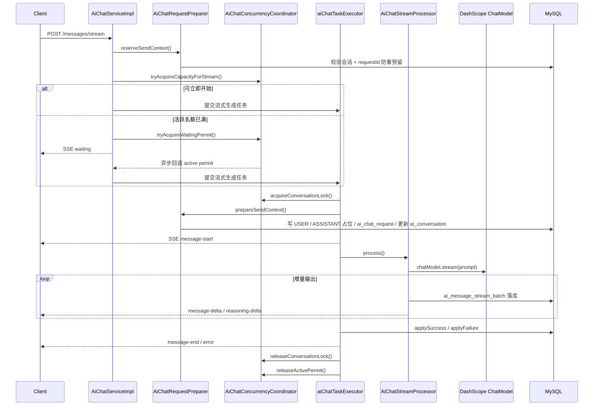

# be-vita AI Chat 设计文档

## 1. 文档目标

本文档面向 `vita-aichat` 后端研发与维护者，描述当前仓库中 AI Chat 的真实实现，而不是抽象方案。

当前事实来源以以下代码和 SQL 为准：

- 接口入口：`vita-aichat/src/main/java/com/vita/controller/aichat/AiChatController.java`
- 聚合服务：`vita-aichat/src/main/java/com/vita/aichat/chat/service/impl/AiChatServiceImpl.java`
- 支撑组件：`vita-aichat/src/main/java/com/vita/aichat/chat/support/*`
- 配置：`vita-aichat/src/main/java/com/vita/aichat/chat/config/AiChatConfiguration.java`
- 表结构：`sql/init/aichat.sql`

本文档重点说明：

- 模块架构与职责分层
- 表设计与业务拆分思路
- 同步/流式消息的执行链路
- DashScope 请求参数构建与响应回写
- 当前已落地的 AI agent 基础能力与后续演进边界

## 2. 模块架构

### 2.1 技术栈

- Web 层：`Spring MVC + SseEmitter`
- 模型接入：`spring-ai-alibaba-starter-dashscope`
- 持久化：`MyBatis-Plus + MySQL`
- 分布式协调：`RedisCache + Redisson`
- 并发执行：`aiChatTaskExecutor` 独立线程池
- 线程池 Bean：`aiChatTaskExecutor`（别名 `aiChatExecutor`）由 `AiChatConfiguration` 在 `vita-aichat` 模块内声明
- 工具库：`Hutool`（`CharSequenceUtil`、`IdUtil`、`BeanUtil`）
- vita-starters -> 被业务模块按需依赖，通过pom.xml引入，不被引入的情况下运行、debug和mvn 都忽略。
- dashscope、fastapi和kimi等不需要单独拆包统一放到`vita-ai-core-spring-boot-starter`中避免模块过分冗余。

```xml
<dependency>
    <groupId>com.alibaba.cloud.ai</groupId>
    <artifactId>spring-ai-alibaba-starter-dashscope</artifactId>
</dependency>
```

### 2.2 分层结构



### 2.3 组件职责

| 组件 | 当前职责 |
| --- | --- |
| `AiChatController` | 暴露 `/chat/**` HTTP/SSE 接口，接收 DTO，返回 `CommonResult` 或 `SseEmitter` |
| `AiChatServiceImpl` | 聚合同步/流式发送、并发治理、SSE 生命周期和结果回写 |
| `AiChatRequestPreparer` | 将发送流程拆成“轻校验与 requestId 预留”以及“持久化消息/请求 + Prompt 组装”两段 |
| `AiChatConcurrencyCoordinator` | 统一管理全局活跃并发、等待队列和会话级互斥锁 |
| `AiChatRedisCoordinator` | 用 `RedisCache` 做 requestId 防重，用 `Redisson` 做 `RLock` 和 `RPermitExpirableSemaphore` |
| `AiChatStreamProcessor` | 处理 `ChatModel.stream(prompt)` 的增量结果、批次聚合、SSE delta 事件和批次落库 |
| `AiChatOutcomeApplier` | 将成功/失败结果回写到消息表、请求表、会话表 |
| `AiChatResponseExtractor` | 从 Spring AI `ChatResponse` 中抽取正文、推理内容、finish reason 和 usage |
| `AiChatExceptionConverter` | 将网络异常、超时、限流等转换为统一业务异常 |
| `AiChatSseWriter` | 统一封装 `CommonStreamResult` 的 SSE 成功/失败事件 |
| `AiChatAssembler` | Entity 与 VO/DTO 转换，构建流式事件 VO |
| `AiChatMessageBuilder` | 构建用户消息、助手占位消息、`AiChatRequest` 实体 |

### 2.4 当前公开接口

- `POST /chat/conversations`
- `GET /chat/conversations`
- `GET /chat/conversations/{conversationId}`
- `POST /chat/conversations/{conversationId}/title`
- `DELETE /chat/conversations/{conversationId}`
- `GET /chat/conversations/{conversationId}/messages`
- `POST /chat/conversations/{conversationId}/messages`
- `POST /chat/conversations/{conversationId}/messages/stream`

说明：

- 路由域保持 `/chat/**` 不变
- 同步接口返回普通 JSON
- 流式接口返回 `SseEmitter`
- 所有会话和消息查询都按当前登录用户隔离

## 3. 表设计与拆分思路

### 3.1 拆分原则

当前数据结构按“会话主状态、逻辑消息、请求生命周期、流式批次、历史摘要”拆分：

- 会话只保存主状态和默认参数
- 消息只保存逻辑消息和最终聚合结果
- 请求保存一次模型调用的生命周期与幂等追踪
- 流式批次保存增量快照，不存每个原始 token
- 摘要保存历史压缩结果，不代替实时消息

这样拆分后，消息展示、请求治理、流式排障、后续摘要压缩可以分别演进。

### 3.2 核心表关系

| 表名 | 关键字段 | 设计目标 |
| --- | --- | --- |
| `ai_conversation` | `id`、`active_request_id`、`current_model_code` | 保存会话配置、运行状态和最近错误 |
| `ai_message` | `id`、`conversation_id`、`reply_to_id`、`request_id` | 保存用户消息和助手最终结果 |
| `ai_chat_request` | `id`、`conversation_id`、`request_id` | 保存单次模型请求生命周期 |
| `ai_message_stream_batch` | `assistant_message_id`、`request_id`、`batch_no` | 保存流式增量快照 |
| `ai_conversation_summary` | `conversation_id`、`version_no` | 保存历史摘要结果 |

### 3.3 `ai_conversation`

`ai_conversation` 解决的是“当前会话以什么配置运行、是否有活跃请求、最近一次失败是什么”。

关键字段：

- `status`：当前代码要求发送消息前必须是 `ACTIVE`
- `current_model_code` / `system_prompt` / `temperature` / `max_tokens` / `max_context_messages`：会话级模型参数
- `summary_version` / `summary_status`：摘要版本与状态
- `active_request_id`：当前正在生成的请求 ID
- `last_error_code` / `last_error_message`：最近一次失败信息
- `tenant_id`：租户隔离
- `pinned` / `last_message_at` / `message_count` / `round_count`：排序与统计
- `current_model_id` / `title_source` / `ext_json`：模型引用、标题来源、扩展字段

### 3.4 `ai_message`

`ai_message` 只保存逻辑消息和最终聚合结果，不保存流式过程切片。

关键点：

- `role_type` 区分 `USER` / `ASSISTANT` / `SYSTEM` / `SUMMARY`
- `reply_to_id` 用于把助手消息关联回用户消息
- `content` / `reasoning_content` 存最终聚合内容
- `content_status` 数据库主状态仍以 `GENERATING`、`DONE`、`ERROR`、`CANCELLED` 为主；`WAITING` 主要用于流式 SSE 事件提示
- `stream_batch_count` 标记该消息最终累计了多少个批次

### 3.5 `ai_chat_request`

`ai_chat_request` 是请求治理表，用来回答“一次模型调用做了什么、执行到了哪里、最终结果如何”。

关键点：

- `(conversation_id, request_id)` 唯一，配合 Redis request mark 实现幂等
- `request_mode` 区分 `SYNC` 和 `STREAM`
- `status` 追踪 `PENDING -> STREAMING -> SUCCESS/ERROR/CANCELLED`
- `user_message_id` / `assistant_message_id` 把一次调用和具体消息绑定
- `provider_request_id` / token 字段 / `finish_reason` 记录供应商返回元数据

### 3.6 `ai_message_stream_batch`

`ai_message_stream_batch` 记录流式过程中的批次快照，而不是 token 明细。

关键字段：

- `assistant_message_id`
- `request_id`
- `batch_no`
- `content_delta`
- `reasoning_delta`
- `flush_reason`
- `delta_chars`
- `provider_sequence`

当前刷批阈值以代码常量为准：

- 时间窗口：`200ms`
- 字符阈值：`64`

### 3.7 `ai_conversation_summary`

`ai_conversation_summary` 只承担历史压缩摘要职责，不承担实时消息存储。

Prompt 构建时只会读取最新 `READY` 摘要，把它作为系统消息插入上下文。

### 3.8 枚举类型

当前代码定义了 9 个枚举类，统一位于 `com.vita.aichat.enums` 包下：

| 枚举类 | 值 | 用途 |
| --- | --- | --- |
| `AiChatRequestModeEnum` | `SYNC`, `STREAM` | 请求模式 |
| `AiChatRequestStatusEnum` | `PENDING`, `STREAMING`, `SUCCESS`, `ERROR`, `CANCELLED` | 请求生命周期状态 |
| `AiConversationStatusEnum` | `ACTIVE`, `ARCHIVED`, `DELETED` | 会话状态 |
| `AiMessageTypeEnum` | `TEXT`, `IMAGE`, `FILE`, `EVENT` | 消息类型 |
| `AiRoleTypeEnum` | `USER`, `ASSISTANT`, `SYSTEM`, `SUMMARY` | 消息角色 |
| `AiStreamFlushReasonEnum` | `TIME_WINDOW`, `CHAR_THRESHOLD`, `FINAL`, `ERROR` | 流式批次落库原因 |
| `AiSummaryStatusEnum` | `NONE`, `READY`, `STALE`, `GENERATING` | 摘要状态 |
| `AiTitleSourceEnum` | `AUTO`, `MANUAL` | 标题来源 |
| `AiContentStatusEnum` | `WAITING`, `GENERATING`, `DONE`, `ERROR`, `CANCELLED` | 消息内容状态（含 SSE 事件中的等待提示） |

## 4. 并发治理与分布式协调

### 4.1 为什么要单独治理并发

AI Chat 的正确性和容量是两件事：

- 正确性：同一会话不能并发生成
- 容量：多人同时使用时，系统需要限制全局生成并发并给出等待反馈

因此当前实现引入了两层治理：

- 会话级互斥：同一会话只能有一个生成请求
- 全局活跃并发：同一时刻只允许固定数量的生成任务真正调用模型

### 4.2 当前实现方式

#### requestId 防重

- Redis key：`aichat:req:{conversationId}:{requestId}`
- 方式：`RedisCache.setIfAbsent + 24h TTL`
- 语义：预留成功后才允许后续进入容量治理

#### 会话锁

- Redis key：`aichat:conv:{conversationId}:lock`
- 实现：`Redisson RLock`
- 模式：固定租期，不启用 watchdog
- 默认租期：`600s`

#### 全局活跃并发

- Redis key：`aichat:concurrency:active`
- 实现：`RPermitExpirableSemaphore`
- 默认上限：`5`
- 默认 permit 租期：`900s`

#### 等待队列

- Redis key：`aichat:concurrency:waiting`
- 实现：`RPermitExpirableSemaphore`
- 默认容量：`20`
- 默认等待超时：`30s`
- 顺序语义：非 FIFO，只保证“有位则等，超时则退”

### 4.3 为什么使用 `RPermitExpirableSemaphore`

当前方案没有用 JVM 本地计数或数据库排队，而是使用 Redisson expirable permit，原因是：

- 多实例部署时共享同一套并发上限
- 节点异常退出时 permit 能自动回收
- 流式等待阶段可以走异步回调，不需要占住业务线程

### 4.4 独立线程池

当前 `vita-aichat` 不再复用全局 `threadPoolTaskExecutor`，而是单独声明：

- Bean：`aiChatTaskExecutor`
- 拒绝策略：`AbortPolicy`
- 默认核心线程数：`8`
- 默认最大线程数：`16`
- 默认队列容量：`0`

`queue-capacity=0` 的目的，是避免“Java 线程池排队”和“分布式等待队列”同时存在，导致等待语义混乱。

## 5. 核心业务链路

### 5.1 创建会话

创建会话流程较轻：

1. 获取当前登录用户
2. 生成雪花 ID
3. 写入默认标题、默认模型编码、默认系统提示词
4. 初始化 `summaryStatus=NONE`
5. 持久化 `ai_conversation`

### 5.2 查询会话与消息

查询链路核心是用户隔离：

- 会话分页按 `userId` 查询
- 会话详情要求会话归属当前用户
- 消息分页要求会话归属当前用户

### 5.3 同步发送消息

同步发送链路：



关键特征：

- 同步接口也参与全局并发治理
- 活跃名额不足时会阻塞等待，而不是立即失败
- 只有拿到活跃名额后，才会去抢会话锁
- `prepareSendContext()` 内部委托给 `@Transactional doPrepareSendContext()`，在单个事务内完成 USER 消息、ASSISTANT 占位、`ai_chat_request` 写入和 `ai_conversation` 更新

### 5.4 流式发送消息

流式发送链路：



关键特征：

- `message-start` 发送时机后移到了真正开始生成之后
- 如果超过并发阈值，先发 `waiting` 事件
- 等待队列阶段不占用 `aiChatTaskExecutor` 工作线程

### 5.5 SSE 事件协议

当前事件名：

- `waiting`
- `message-start`
- `message-delta`
- `reasoning-delta`
- `message-end`
- `error`

其中：

- `waiting`：`assistantMessageId` 可以为空，`contentStatus=WAITING`
- `message-start`：表示已经拿到名额、拿到会话锁并完成预处理
- `message-delta` / `reasoning-delta`：正文和推理增量分开发送
- `message-end`：最终结束事件，附带 token 和 finish reason
- `error`：容量不足、等待超时、线程池拒绝、模型异常等统一通过该事件返回

## 6. 大模型请求构建与响应处理

### 6.1 请求前构建

发送链路被显式拆成两段：

#### 第一段：轻校验与 requestId 预留

`AiChatRequestPreparer.reserveSendContext()` 负责：

1. 生成或标准化 `requestId`
2. 校验消息类型，当前只允许 `TEXT`
3. 校验会话存在且归属当前用户
4. 校验会话 `status=ACTIVE`
5. 校验 `(conversationId, requestId)` 没有重复
6. 用 Redis 预留 request mark

#### 第二段：正式准备上下文

`AiChatRequestPreparer.prepareSendContext()` 只在以下条件都满足后执行：

- 已拿到活跃并发名额
- 已拿到会话锁

这一步会完成：

- 写入 `USER` 消息
- 写入 `ASSISTANT` 占位消息
- 写入 `ai_chat_request`
- 更新 `ai_conversation.active_request_id`
- 构建 Spring AI `Prompt`

### 6.2 Prompt 组装顺序

当前 Prompt 顺序固定为：

1. `systemPrompt`
2. 最新 `READY` 摘要
3. 最近上下文消息
4. 当前用户消息

历史消息筛选规则：

- 只读取 `use_context=1` 的消息
- 排除当前这条用户消息
- 上下文条数取 `conversation.max_context_messages`，为空或非法时回退到 `spring.ai.max.context.messages`

### 6.3 DashScope 参数构建

当前通过 `DashScopeChatOptions` 构建模型选项，真实代码行为如下：

- `model(modelCode)`
- `stream(stream)`
- `incrementalOutput(stream)`
- `enableSearch(true)`
- `enableThinking(isThinkingModel(modelCode))`
- `maxToken(conversation.maxTokens)`，仅在会话配置有值时设置
- `temperature(conversation.temperature)`，仅在会话配置有值时设置

思考模式开启规则：

- 当 `modelCode` 以 `qwq-` 开头时，`enableThinking=true`

### 6.4 响应处理

#### 同步响应

同步请求走：

- `chatModel.call(prompt)`
- `AiChatResponseExtractor.extractCompletion(response)`
- `AiChatOutcomeApplier.applySuccess/applyFailure(...)`

#### 流式响应

流式请求走：

- `chatModel.stream(prompt)`
- `AiChatResponseExtractor.extractChunk(response)`
- `AiStreamBatchAccumulator` 聚合批次
- `ai_message_stream_batch` 落库
- `AiChatSseWriter` 推送 SSE
- `AiChatOutcomeApplier` 回写最终结果

## 7. AI agent 相关知识点与演进边界

### 7.1 当前已具备的 agent 基础能力

当前 `aichat` 已具备一部分 AI agent runtime 的基础要素，但还不是完整 agent 编排系统。

已经具备：

- Provider：当前固定为 DashScope
- Model：按 `modelCode` 选择具体模型
- Prompt：支持系统提示词、摘要、历史上下文、当前输入
- Context Window：支持最近上下文消息截断
- Summary Memory：通过 `ai_conversation_summary` 预留长期摘要压缩能力
- Request Lifecycle：`ai_chat_request` 记录一次模型调用的完整生命周期
- Idempotency：`requestId + Redis mark + DB 唯一键`
- Streaming Snapshot：`ai_message_stream_batch`
- Reasoning Content：独立存储 `reasoning_content`

### 7.2 当前还不是完整 agent 的原因

当前系统还没有落地以下能力：

- Tool Calling / Function Calling
- RAG 检索链路
- 长期记忆回写与召回
- Planning / ReAct / 多步任务编排
- MCP / 外部工具协议接入

因此更准确的定位是：

- 当前是“具备 agent 基础能力的会话式 AI Chat”
- 还不是“完整的 AI agent orchestration runtime”

### 7.3 后续演进建议

未来如果要继续演进成 agent 运行时，建议在当前结构上扩展，而不是推翻：

- 在 `ai_chat_request` 上扩展 `tool_calls_json`
- 在 `ai_message` 上扩展工具事件消息类型
- 新增检索结果与引用片段表，支撑 RAG
- 把摘要从“单纯历史压缩”扩展为“长期记忆”
- 为工具执行、规划步骤和外部回调新增专属生命周期表

## 8. 关键配置

当前实现依赖的核心配置如下：

```yaml
spring:
  ai:
    model:
      chat: dashscope
    default-system-prompt: 你是一个严谨的开发助手。
    lock:
      conversation:
        lease-seconds: 600
    concurrency:
      max-active: 5
      max-waiting: 20
      wait-timeout-seconds: 30
      active-permit-lease-seconds: 900
    executor:
      core-pool-size: 8
      max-pool-size: 16
      queue-capacity: 0
      keep-alive-seconds: 60
    max-context-messages: 12
    stream:
      enabled: true
    dashscope:
      api-key: local-dashscope-key
      base-url: https://dashscope.aliyuncs.com
      chat:
        options:
          model: qwen-plus
```

启动时会额外校验：

说明：代码中 `AiChatProperty` 使用 `@Value("${spring.ai.xxx}")` 平铺方式读取，上述 YAML 为等效的嵌套写法，Spring Boot 解析结果一致。

- DashScope 相关配置是否完整
- Redis / Redisson 是否可用
- `max-active > 0`
- `max-waiting >= 0`
- `wait-timeout-seconds > 0`
- `max-pool-size >= max-active`

## 9. 当前实现结论

当前 `vita-aichat` 的结论可以概括为：

- 对外继续保持 Spring MVC + SSE
- 对内统一通过 Spring AI 调用 DashScope
- 存储上采用“最终消息主表 + 请求生命周期表 + 流式批次表”
- 并发上采用“全局活跃名额 + 等待队列 + 会话级分布式锁”
- 线程模型上采用 `aichat` 独立线程池，避免复用全局业务线程池

这使得当前系统已经能在多实例部署下正确支持“多人同时使用、同会话串行、超限等待提示”的 AI Chat 基础能力。
