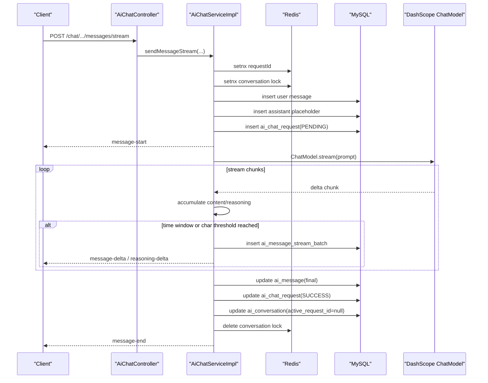

# be-vita AI Chat 设计文档

## 1. 目标

`vita-aichat` 保持 `Spring MVC + SSE` 技术栈，对外继续提供 `/chat/**` 接口；内部统一使用 `spring-ai-alibaba-starter-dashscope` 和 `ChatModel.call/stream`。

本轮重点不是把每个原始 token 都落库，而是把流式回复按批次切片后再落库，最终形成三层数据：

- 会话主表：记录会话状态和最近一次请求态
- 最终消息表：记录用户消息和助手最终聚合结果
- 流式批次表：记录中间分批快照，便于恢复、排障和审计

## 2. 依赖与配置

### 2.1 依赖

```xml
<dependency>
    <groupId>com.alibaba.cloud.ai</groupId>
    <artifactId>spring-ai-alibaba-starter-dashscope</artifactId>
</dependency>
```

### 2.2 配置约定

按用户要求，配置保留在 profile 配置文件里，不改为环境变量占位。`vita-aichat/src/main/resources/application-dev.yml` 和 `application-prod.yml` 统一使用下面这套结构：

```yaml
spring:
  ai:
    model:
      chat: dashscope
    default-system-prompt: 你是一个严谨的开发助手。
    max:
      context:
        messages: 12
    stream:
      enabled: true
    connect:
      timeout: 5000
    read:
      timeout: 60000
    dashscope:
      api-key: please-set-real-dashscope-key
      base-url: https://dashscope.aliyuncs.com
      chat:
        options:
          model: qwen-plus
```

说明：

- `spring.ai.model.chat` 当前只支持 `dashscope`
- `spring.ai.dashscope.base-url` 固定指向 DashScope 官方入口
- `qwq-*` 模型会自动开启 `enableThinking`
- 文档中的 `api-key` 使用配置文件占位字符串，实际值由部署时维护

## 3. 表结构

### 3.1 `ai_conversation`

在原有会话表基础上新增：

- `active_request_id`：当前正在生成中的请求 ID
- `last_error_code`：最近一次失败错误码
- `last_error_message`：最近一次失败信息

### 3.2 `ai_message`

继续一条逻辑消息一行，`USER` 与 `ASSISTANT` 都存这里。新增：

- `provider_request_id`
- `finish_reason`
- `first_token_at`
- `completed_at`
- `stream_batch_count`

`content` 与 `reasoning_content` 只保存最终聚合后的完整结果。

### 3.3 `ai_chat_request`

新增请求生命周期表，一条发送请求一行，唯一键为 `(conversation_id, request_id)`。核心字段：

- `request_mode`：`SYNC` / `STREAM`
- `status`：`PENDING` / `STREAMING` / `SUCCESS` / `ERROR` / `CANCELLED`
- `user_message_id`
- `assistant_message_id`
- `model_code`
- `provider_request_id`
- `finish_reason`
- `token_input` / `token_output` / `token_total`
- `started_at` / `first_token_at` / `completed_at`
- `error_code` / `error_message`

### 3.4 `ai_message_stream_batch`

新增流式批次快照表，一条批次一行，唯一键为 `(assistant_message_id, batch_no)`。核心字段：

- `assistant_message_id`
- `request_id`
- `batch_no`
- `content_delta`
- `reasoning_delta`
- `flush_reason`
- `delta_chars`
- `provider_sequence`

`flush_reason` 枚举：

- `TIME_WINDOW`
- `CHAR_THRESHOLD`
- `FINAL`
- `ERROR`

### 3.5 `ai_conversation_summary`

本轮不调整摘要表职责，仍只负责会话压缩摘要，不要求历史数据回填批次快照。

## 4. Redis 角色

Redis 只做轻量协调，不存上下文，不存 chunk 主数据。

使用两个 key：

- `aichat:conv:{conversationId}:lock`
  - 会话级互斥锁，防止同一会话并发生成
- `aichat:req:{conversationId}:{requestId}`
  - 请求幂等标记，防止相同 `requestId` 重复落库

行为约定：

- 命中重复 `requestId` 返回 `CHAT_REQUEST_DUPLICATE`
- 同会话已有生成任务时返回 `CHAT_GENERATING_CONFLICT`
- 如果在预处理阶段抢锁失败或事务回滚，会释放本次错误占用的 `requestId`
- Redis 不可用时退化到进程内 `ConcurrentHashMap`，仅保证单实例最小可用

## 5. 调用链路

### 5.1 同步发送

1. 校验会话归属与状态
2. 生成 `requestId`
3. 占用请求幂等标记与会话锁
4. 写入 `USER` 消息
5. 写入 `ASSISTANT` 占位消息，状态为 `GENERATING`
6. 写入 `ai_chat_request`，状态为 `PENDING`
7. 组装 `Prompt`
8. 调用 `ChatModel.call(prompt)`
9. 回写 `ai_message` 最终内容与 token 信息
10. 回写 `ai_chat_request` 为 `SUCCESS/ERROR`
11. 清空 `ai_conversation.active_request_id`

### 5.2 流式发送

1. 与同步链路共用预处理
2. 发送 `message-start`
3. 调用 `ChatModel.stream(prompt)`
4. 内存累积正文增量与推理增量
5. 满足以下任一条件时落一批 `ai_message_stream_batch`
   - 间隔达到 1000ms
   - 累积字符数达到 512
6. 批次落库后推送 SSE 增量事件
7. 结束或异常时强制 flush 最后一批
8. 最终聚合回写 `ai_message`
9. 结束 `ai_chat_request`
10. 释放会话锁

## 6. SSE 协议

流式接口保持：

- `POST /chat/conversations/{conversationId}/messages/stream`

事件名固定：

- `message-start`
- `message-delta`
- `reasoning-delta`
- `message-end`
- `error`

事件体统一包含：

- `conversationId`
- `assistantMessageId`
- `requestId`
- `batchNo`
- `contentStatus`
- `finishReason`

结束事件额外返回：

- `firstTokenAt`
- `completedAt`
- `tokenInput`
- `tokenOutput`
- `tokenTotal`

## 7. 参考实现说明

参考 `/Users/zhuningkang/Documents/git/github/bailian-agent` 的流式消费方式，借鉴点仅限于：

- 使用 DashScope 原生流式返回
- 逐段提取正文与推理内容
- 在服务层聚合后再统一输出

不照搬其 `WebFlux Controller` 形式，`be-vita` 仍保持 `Spring MVC + SseEmitter`。

## 8. 时序图



## 9. 验收点

- `/chat/**` 接口不改路由前缀
- 同步与流式都落 `ai_chat_request`
- 流式过程按批次写入 `ai_message_stream_batch`
- `ai_message` 能返回 `contentStatus`、`finishReason`、`firstTokenAt`、`completedAt`
- `requestId` 防重和会话并发锁都能生效
- SQL 初始化脚本与升级脚本都可用
